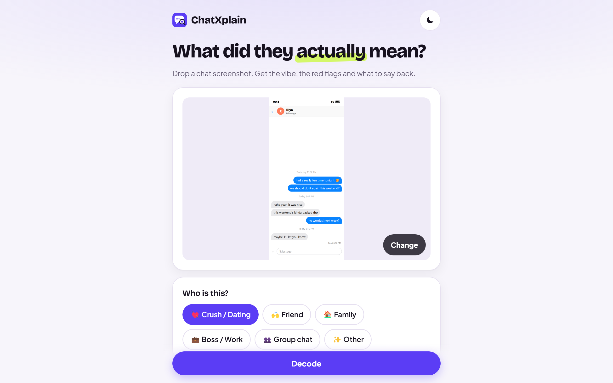
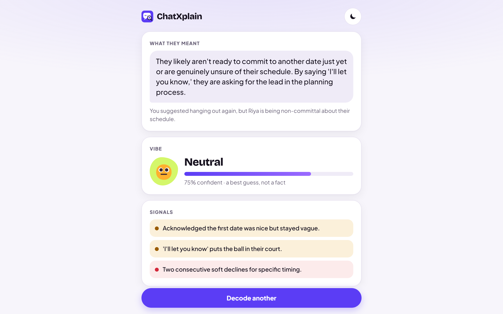
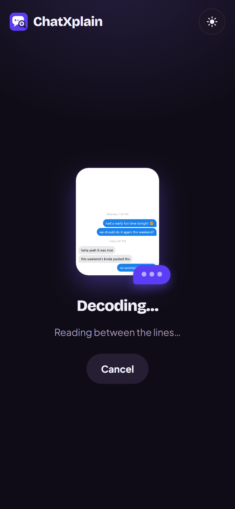
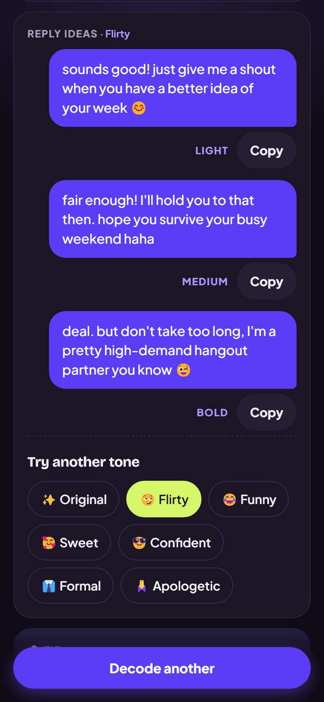

# ChatXplain

**Your private texting coach that remembers your relationships.** Drop a chat screenshot to see what they meant, how things changed since last time, and three replies that sound like you, in any tone. ChatXplain is an app on [Anna](https://anna.partners).

- [Privacy policy](privacy/)
- Contact: harshal456951@gmail.com

## Screenshots

 
